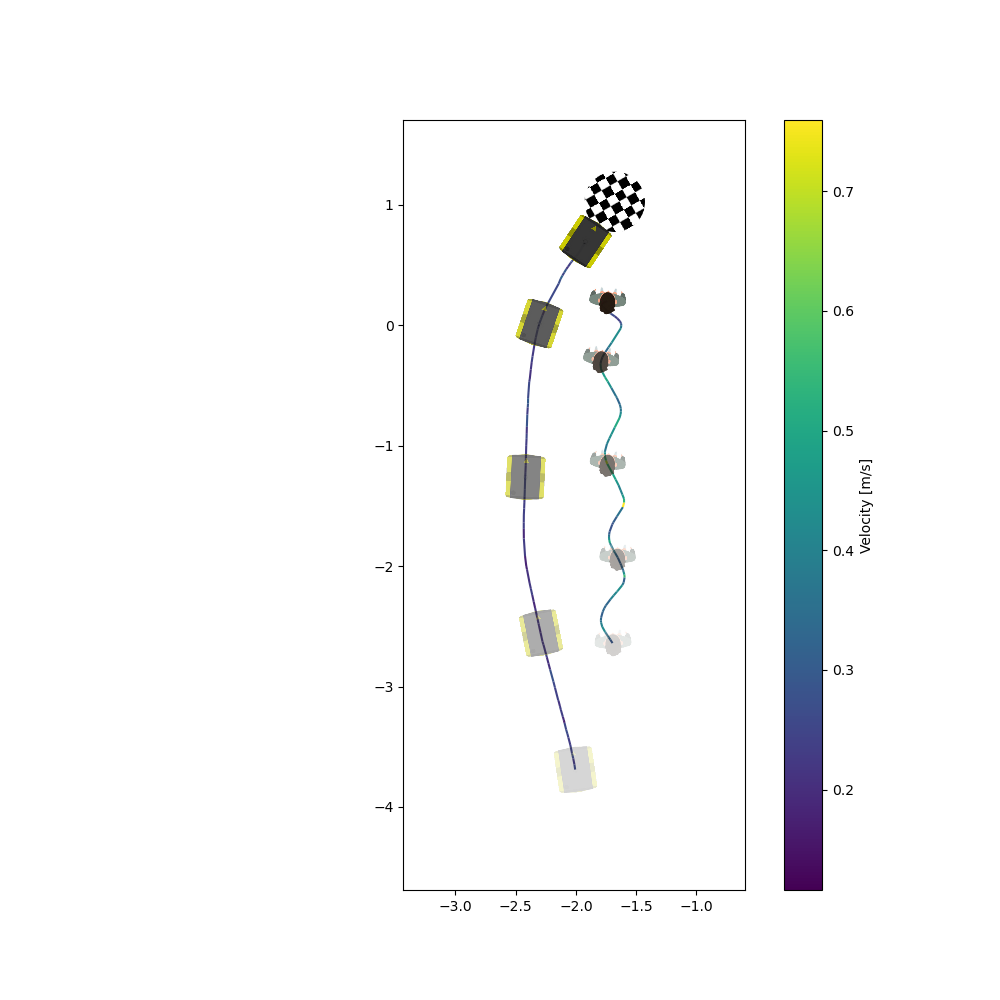
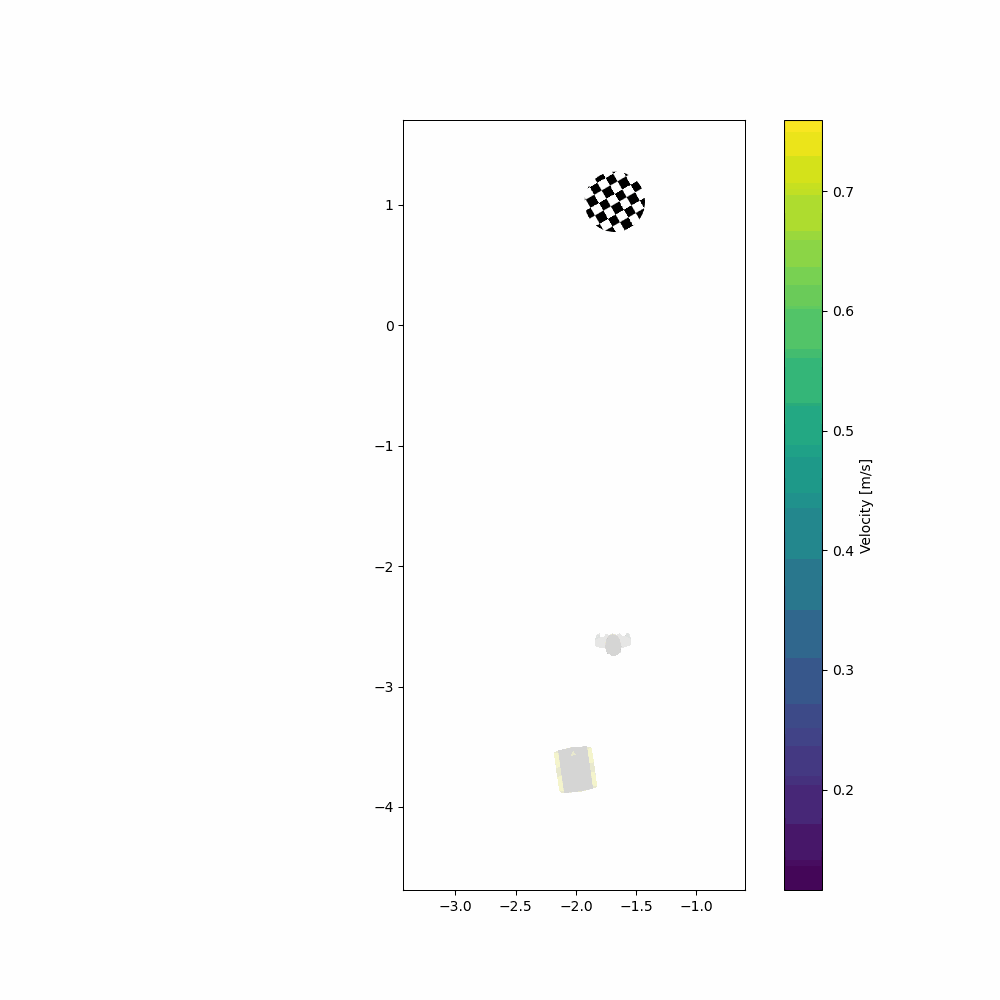

Elaborate trajectory
====================

This is a package that provides a way to analyze the trajectory of the robot in the social navigation task.
The package uses the data that are collected from the rosbag file and converts them to a pickle file. The pickle file is then used to analyze the trajectory of the robot.

Usage of the plot_trajectories code
-----------------------------------

After the conversion of the data from the rosbag to the pickle file, you can use the following code to analyze the trajectory of the robot.

.. code-block:: bash

    plot_trajectories -h # to see the help message

To run the code, you need to provide:

- The path to the pickle file that contains the data of the robot trajectory.
- The path to the config file that contains the information about the experiments that we want to plot the trajectory for.
- The path to output directory where the plot will be saved.

.. code-block:: bash

    plot_trajectories --pickle-file <path_to_pickle_file> --config-file <path_to_config_file> --output-dir <path_to_output_dir>

The config file should contain the following information:

.. code-block:: yaml

    # trajectory_plots.yaml
    plot_single: True # plot the trajectory of the robot
    plot_aggregated: False # plot the aggregated trajectory of the robot (experimental)

    experiments: # the experiments that we want to plot the trajectory for
      experiment_1:
        name: "Experiment 1"
        path: "<path_to_experiment_1_pickle_file>"

Output
------

The output of the code is an animation and a plot of the trajectory of the robot in the social navigation task.

Example
-------

The following is an example of the output of the code.

The following is the trajectory of the robot in the social navigation task.

The following is the animation of the trajectory of the robot in the social navigation task.

.. toctree::
    :maxdepth: 2